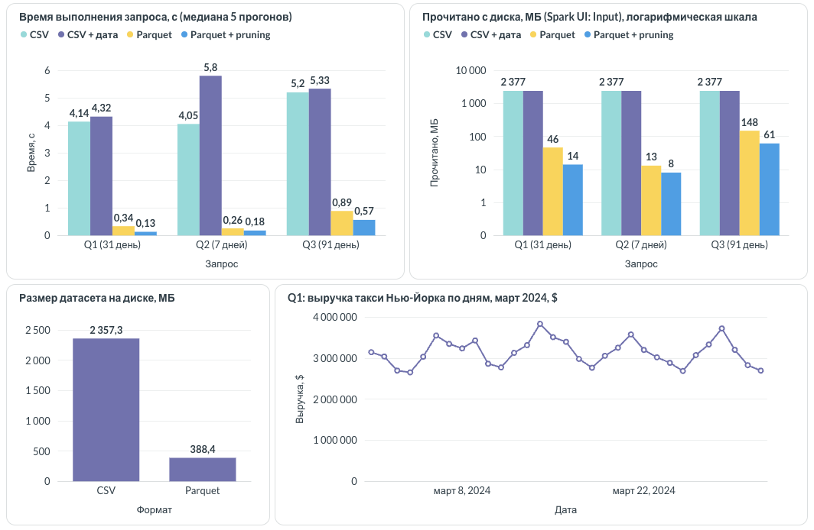

# ДЗ №3. CSV против Parquet с партиционированием по дате

## 1. Данные

| | |
|---|---|
| Источник | NYC TLC Yellow Taxi, январь - июнь 2024 |
| Строк | 20 332 054 |
| Колонок | 20 (19 исходных + `pickup_date`) |
| CSV | 2357 МБ, 8 файлов, без партиций |
| Parquet | 388 МБ (в 6,1 раза меньше), snappy, `partitionBy("pickup_date")`, 182 партиции |
| Тип timestamp | `TIMESTAMP_MICROS` |

## 2. Стенд и методика

| | |
|---|---|
| Движок | Spark 4.0.1, PySpark, `local[*]`, Java 21 |
| Машина | MacBook Air M3, 8 ядер, 24 ГБ, SSD, тёплый page cache |
| Время | медиана 5 прогонов после прогрева |
| Прочитано | `inputBytes` стадий запроса (Spark UI, колонка Input) |
| Файлы | метрики узла Scan: `number of files read`, `number of partitions read` |
| Планы | `EXPLAIN FORMATTED`, `results/plans/` |

## 3. Запросы

| | Запрос | Диапазон | Партиций |
|---|---|---|---|
| Q1 | поездки и выручка по дням | март | 31 из 182 (17 %) |
| Q2 | % чаевых по часу и способу оплаты | 13-19 мая | 7 из 182 (4 %) |
| Q3 | топ-10 зон посадки по выручке, join со справочником | апрель - июнь | 91 из 182 (50 %) |

Q1, наивный:

```sql
SELECT pickup_date, count(*) AS trips, round(sum(total_amount), 2) AS revenue, round(avg(trip_distance), 2) AS avg_distance
FROM (SELECT * FROM trips WHERE tpep_pickup_datetime >= TIMESTAMP'2024-03-01 00:00:00'
                            AND tpep_pickup_datetime <  TIMESTAMP'2024-04-01 00:00:00') t
GROUP BY pickup_date ORDER BY pickup_date
```

Q1, оптимизированный:

```sql
SELECT pickup_date, count(*) AS trips, round(sum(total_amount), 2) AS revenue, round(avg(trip_distance), 2) AS avg_distance
FROM (SELECT pickup_date, total_amount, trip_distance FROM trips
      WHERE pickup_date BETWEEN DATE'2024-03-01' AND DATE'2024-03-31') t
GROUP BY pickup_date ORDER BY pickup_date
```

Q2, оптимизированный:

```sql
SELECT hour(tpep_pickup_datetime) AS hour, payment_type, count(*) AS trips,
       round(avg(tip_amount / fare_amount) * 100, 2) AS tip_pct
FROM (SELECT tpep_pickup_datetime, payment_type, tip_amount, fare_amount FROM trips
      WHERE pickup_date BETWEEN DATE'2024-05-13' AND DATE'2024-05-19' AND fare_amount > 0) t
GROUP BY 1, 2 ORDER BY 1, 2
```

Q3, оптимизированный:

```sql
SELECT z.Borough, z.Zone, count(*) AS trips, round(sum(t.total_amount), 2) AS revenue
FROM (SELECT PULocationID, total_amount, trip_distance FROM trips
      WHERE pickup_date BETWEEN DATE'2024-04-01' AND DATE'2024-06-30' AND trip_distance > 0) t
JOIN zones z ON t.PULocationID = z.LocationID
GROUP BY 1, 2 ORDER BY revenue DESC LIMIT 10
```

## 4. Результаты

| Запрос | Формат | Вариант | Время, с | Прочитано, МБ | Файлов |
|---|---|---|---|---|---|
| Q1 | CSV | наивный | 4,138 | 2376,6 | 8 |
| Q1 | CSV | оптимизированный | 4,317 | 2376,6 | 8 |
| Q1 | Parquet | наивный | 0,337 | 45,6 | 182 |
| Q1 | Parquet | **оптимизированный** | **0,133** | **14,1** | **31** |
| Q2 | CSV | наивный | 4,049 | 2376,6 | 8 |
| Q2 | CSV | оптимизированный | 5,797 | 2376,6 | 8 |
| Q2 | Parquet | наивный | 0,258 | 12,9 | 182 |
| Q2 | Parquet | **оптимизированный** | **0,179** | **8,0** | **7** |
| Q3 | CSV | наивный | 5,197 | 2376,6 | 8 |
| Q3 | CSV | оптимизированный | 5,331 | 2376,6 | 8 |
| Q3 | Parquet | наивный | 0,889 | 148,4 | 182 |
| Q3 | Parquet | **оптимизированный** | **0,566** | **61,0** | **91** |

| Ускорение | Q1 | Q2 | Q3 |
|---|---|---|---|
| CSV / Parquet наивный, время | 12,3× | 15,7× | 5,8× |
| Parquet наивный / оптимизированный, время | 2,5× | 1,4× | 1,6× |
| Parquet наивный / оптимизированный, байты | 3,2× | 1,6× | 2,4× |
| **CSV / Parquet оптимизированный, время** | **31×** | **23×** | **9,2×** |
| **CSV / Parquet оптимизированный, байты** | **169×** | **297×** | **39×** |

Выводы:

- CSV: 2377 МБ в любом варианте, фильтр по дате не помогает (Q2: +1,7 с).
- Parquet без правок запроса: в 6-16 раз быстрее.
- Фильтр по партиции: 31 / 7 / 91 файлов из 182.
- Q2 (4 % партиций): 297× по байтам, Q3 (50 %): 39×.

## 5. Планы запросов

### 5.1 Partition pruning

Q1 Parquet, наивный:

```text
HashAggregate (4)
+- Project (3)
   +- Filter (2)
      +- Scan parquet (1)

PushedFilters: [IsNotNull(tpep_pickup_datetime), GreaterThanOrEqual(tpep_pickup_datetime,2024-03-01 00:00:00.0),
                LessThan(tpep_pickup_datetime,2024-04-01 00:00:00.0)]
ReadSchema: struct<tpep_pickup_datetime:timestamp,trip_distance:double,total_amount:double>
```

Q1 Parquet, оптимизированный:

```text
HashAggregate (2)
+- Scan parquet (1)

PartitionFilters: [isnotnull(pickup_date), (pickup_date >= 2024-03-01), (pickup_date <= 2024-03-31)]
ReadSchema: struct<trip_distance:double,total_amount:double>
```

- `PartitionFilters`: отбор каталогов `pickup_date=…/` до чтения, открыт 31 файл из 182.
- `pickup_date` не читается из файлов, узла `Filter` нет.
- В наивном варианте `PartitionFilters` пуст.

### 5.2 Predicate pushdown

Q2 Parquet, оптимизированный:

```text
PartitionFilters: [isnotnull(pickup_date), (pickup_date >= 2024-05-13), (pickup_date <= 2024-05-19)]
PushedFilters: [IsNotNull(fare_amount), GreaterThan(fare_amount,0.0)]
ReadSchema: struct<tpep_pickup_datetime:timestamp,payment_type:bigint,fare_amount:double,tip_amount:double>
```

Q2 Parquet, наивный, pushdown выкл/вкл:

| `spark.sql.parquet.filterPushdown` | Время, с | Прочитано, МБ | Файлов |
|---|---|---|---|
| false | 0,331 | 174,5 | 182 |
| true | 0,238 | 12,9 | 182 |

- Pushdown по min/max row group: −93 % байт, открыты все 182 файла.
- INT96 (по умолчанию): наивный Q1 читал 189,7 МБ вместо 45,6, min/max нет.
- `fare_amount > 0` не отсекает ни одной row group.

### 5.3 Проекция

Март, запись в `noop`:

| Формат | Колонки | Время, с | Прочитано, МБ |
|---|---|---|---|
| CSV | 20 | 8,984 | 2376,6 |
| CSV | 3 | 4,052 | 2376,6 |
| Parquet | 20 | 0,409 | 68,8 |
| Parquet | 3 | 0,153 | 14,1 |

- Parquet: −80 % байт.
- CSV: байты те же, −55 % времени.

## 6. Дашборд



## 7. За счёт чего ускорились запросы

| Механизм | Без | С |
|---|---|---|
| Колоночный формат + сжатие | 2357 МБ | 388 МБ |
| Проекция колонок | 68,8 МБ | 14,1 МБ |
| Бинарные типы вместо текста | ~4 с на разбор CSV | 0 |
| Predicate pushdown | 174,5 МБ | 12,9 МБ |
| Partition pruning | 182 файла | 31 / 7 / 91 файлов |

Итог: Parquet с фильтром по партиции быстрее CSV в 9-31 раз, читает в 39-297 раз меньше.
